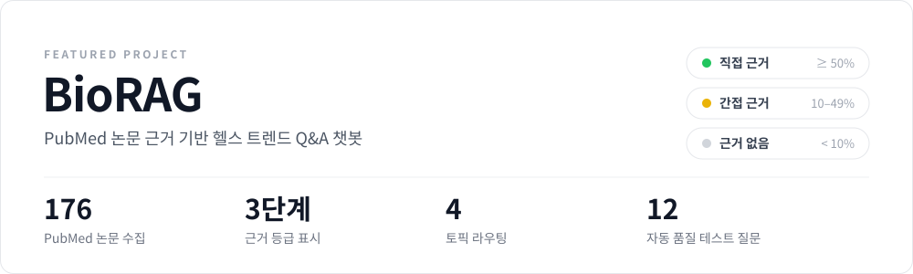

### 안녕하세요, 김주희입니다.

LLM·RAG 기반 AI 서비스를 만듭니다. 
근거 있는 답변을 만드는 일에 관심이 많아요!!

 

GLP-1, 영양제, 공복 루틴 같은 헬스 트렌드 질문에 **PubMed 논문에서 검색한 내용으로만** 답하고, 
근거 수준을 3단계로 보여주는 RAG 챗봇입니다.

- 시스템 아키텍처 설계, LangGraph RAG 파이프라인 설계
- PubMed·보조 문서 크롤링, Docker 개발 환경 구축
- 진행 중 — 골든셋 구축과 RAGAS 기반 품질 평가

[Repository](https://github.com/edi54/BioRAG) · [v4 Team Repo](https://github.com/SKNETWORKS-FAMILY-AICAMP/SKN25-4th-4Team) · [v3 Team Repo](https://github.com/SKNETWORKS-FAMILY-AICAMP/SKN25-3rd-4Team)

<!-- 아키텍처 사진: assets 폴더에 architecture.png로 올린 뒤, 이 주석의 첫 줄과 마지막 줄을 지우면 보여요.

-->

 

### Stack

| Category | Technologies |
| :-- | :-- |
| Languages |    |
| AI · LLM |     |
| ML · DL |      |
| Backend |    |
| Frontend |    |
| Database |    |
| Data · MLOps |   |
| Infrastructure |     |
| DevOps |     |
| Collaboration |    |

 

### Other

- [hey_apple](https://github.com/2022-Winter-Bootcamp-team-L/frontend) — 과일 인식으로 가격을 매기고 영수증을 이메일로 보내 주는 서비스 · 2022 Winter Bootcamp

 

### Contact

[Email](mailto:joohee031104@gmail.com) · [Blog](https://velog.io/@akffkd03) · [GitHub](https://github.com/edi54)
